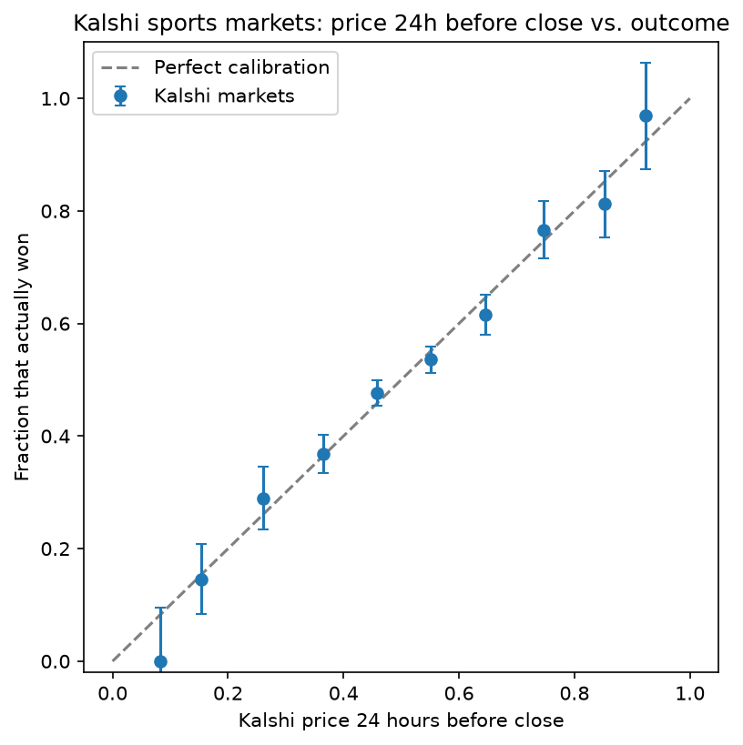
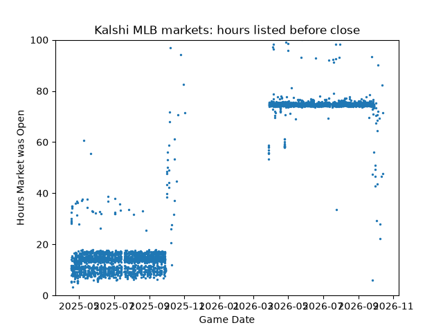
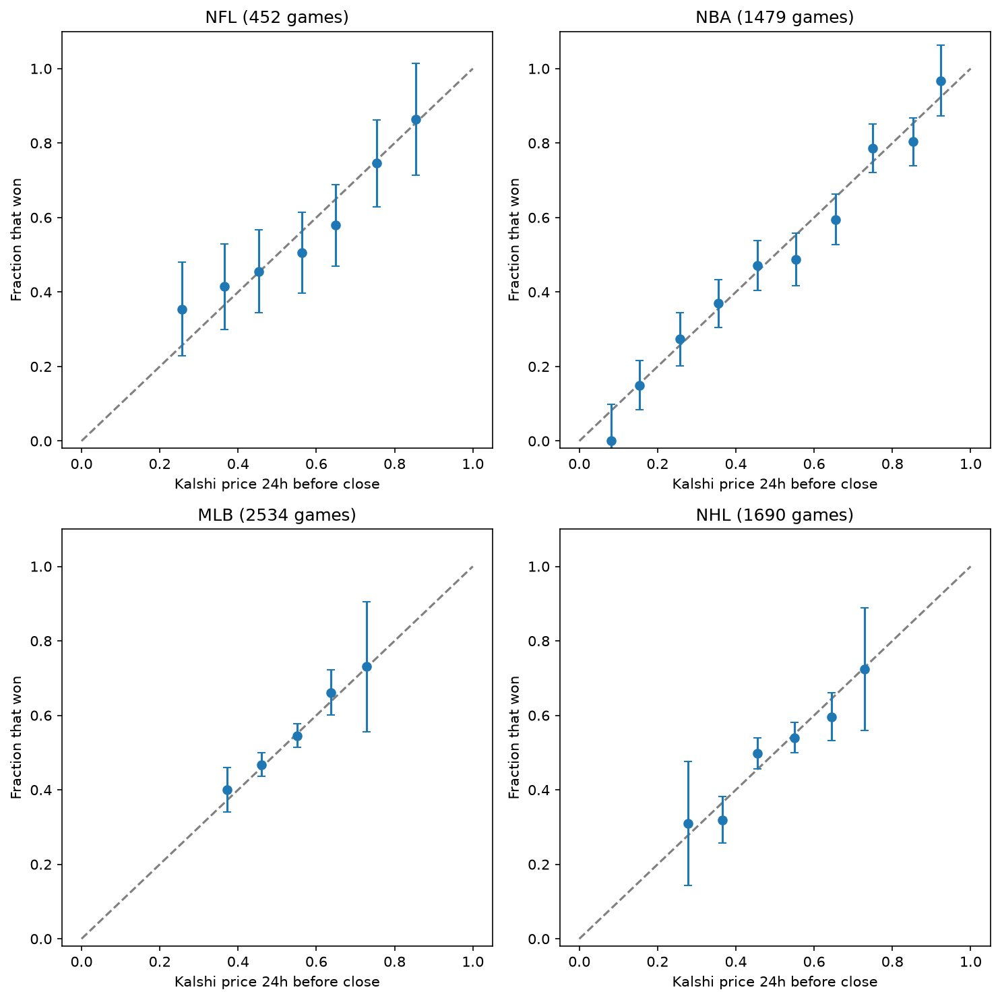

# Are Kalshi Sports Markets Well Calibrated?

Kalshi's sports prices are well calibrated. Using 6,155 NFL, NBA, MLB and NHL games, I found this held in all four leagues. In every price range, the gap between Kalshi's price and the actual win rate was small enough to be explained by random chance. Overall, the Brier score was 0.233, versus 0.25 for guessing 50%, a 7% improvement.

## The question

When a Kalshi market says a team has a 70% chance to win, does that team actually win about 70% of the time? This project measures that for every settled NFL, NBA, MLB and NHL game-winner market I could pull from Kalshi's public API.

## Data

- **Source:** Kalshi's public trade API (no account needed): `/markets`, `/historical/markets`, and the market candlestick endpoints.
- **Series:** `KXNFLGAME`, `KXNBAGAME`, `KXMLBGAME`, `KXNHLGAME`.
- **Raw pull:** 16,890 settled markets (each game has two mirror-image markets, one per team).
- **Cleaning steps:**
  1. Dropped 202 duplicate tickers that appeared in both the live and historical endpoints.
  2. Kept only markets that resolved `yes` or `no` (dropped 44 `scalar` settlements, e.g. postponed games).
  3. Dropped 13 markets that never traded.
  4. Kept **one market per game**, chosen at random (`random_state=42`), so each game counts once and prices span the full 0–100% range.
  5. Kept only markets listed at least 24 hours before close (see note below).
  6. Dropped 11 markets with no price available near the 24-hour mark.
- **Final dataset:** 6,155 games — MLB 2,534 · NHL 1,690 · NBA 1,479 · NFL 452.

**Note on MLB:** Kalshi listed 2025 regular-season MLB games only 5–18 hours before close, then switched to listing them ~3 days ahead for the 2026 season. Because I score prices 24 hours out, the MLB sample is mostly the 2026 season plus the 2025 playoffs.

## Method

- **Price used:** the market price **24 hours before close**, taken from hourly candlesticks (the candle closest to the 24-hour mark; if no trade happened that hour, the bid/ask midpoint). The final pre-close price is useless for this — by then the outcome is known (it scores a meaningless Brier of 0.0008).
- **Brier score:** the mean squared difference between price and outcome:

  $$\text{Brier} = \frac{1}{N}\sum_{i=1}^{N}(p_i - o_i)^2$$

  Lower is better; always guessing 50% scores 0.25.
- **Calibration curve:** prices grouped into 10% bins; each bin's average price is plotted against the fraction of those teams that won. Error bars are ±2 standard errors, $\sqrt{\bar p(1-\bar p)/n}$. Bins with fewer than 20 games are hidden in the per-league charts.
- **API etiquette:** requests are paced and retried with exponential backoff on HTTP 429 (rate limit).

## Results

| League | Games | Brier score | Improvement over 50% guess | Price spread (std) |
|---|---|---|---|---|
| NBA | 1,479 | 0.205 | 18% | 0.22 |
| NFL | 452 | 0.225 | 10% | 0.18 |
| NHL | 1,690 | 0.243 | 3% | 0.10 |
| MLB | 2,534 | 0.244 | 2% | 0.08 |
| **All** | **6,155** | **0.233** | **7%** | |

Across all four leagues, the points roughly follow the diagonal and nearly every error bar crosses the diagonal. Even so, the Brier scores range from 0.205 in the NBA to 0.244 in MLB. The difference comes from how predictable each sport is. NBA prices are spread about 2.7 times wider than MLB's (0.22 vs 0.08), because a favored team in the NBA is much more likely to win. Baseball games are often tossups, and there usually is not a big favorite. In other words, the leagues differ in how predictable they are, not in how honest the prices are.

## A trap I found: trading volume

I also tested whether heavily traded games are better priced by splitting games into four groups by volume quartiles. Surprisingly, the highest-volume group was the worst calibrated, with a calibration error of 0.080 compared with about 0.02-0.04 for the others. The problem is that the volume number includes in-game trading, and upsets and comebacks attract more in-game trading. So sorting games by volume partly sorts them by whether something surprising happened, a form of look-ahead bias. In the high-volume group, underdogs priced at 15% won 29%, and favorites priced at 85% won only 64%. This isn't a league effect: the high-volume group is mostly NBA games, which are well calibrated on their own. So total volume can't be used to test this. A fair test would use only the volume traded before the 24h mark.

## Limitations

* Only four sports were used, with game-winner markets only
* There is a relatively small sample size for NFL (452 games), which gives wider error bars
* The MLB sample is mostly one season (2026), because Kalshi listed earlier games too close to game time
* Prices were only measured at one point (24h before close)

## What I'd do next

* Redo volume test using volume traded before 24h mark from candlesticks
* Expand prices used to 1 hour and 7 days before close
* Compare Kalshi prices to sportsbook closing odds

## How to run

1. Python 3.14 with `requests`, `pandas`, `numpy`, `matplotlib`, `jupyter`.
2. Open `kalshi_calibration.ipynb`. With `DOWNLOAD = False` and `FETCH_PRICES = False` (the defaults), it loads `markets.csv` / `clean_markets.csv` and runs the analysis in under a minute.
3. Set either flag to `True` to re-pull data from Kalshi (the price fetch takes ~30–60 minutes).

## Files

- `kalshi_calibration.ipynb` — the full analysis
- `markets.csv` — raw settled markets
- `clean_markets.csv` — cleaned dataset with 24h prices
- `charts/` — figures used above